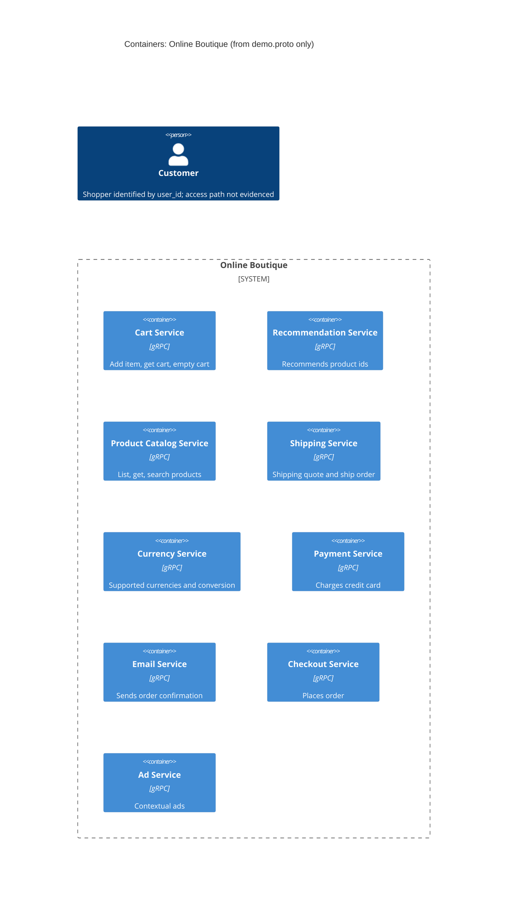

# Task 1A: Recovered architecture (C4 container level)

## 1. Agent

- Product: Claude Code
- Model: Claude Opus 5.5 (`claude-opus-5-5`)

## 2. Files read

- `prompts/1-recover-architecture.md` (task instructions)
- `system/online-boutique/protos/demo.proto` (the only evidence file)

## 3. Containers table

The evidence is a single proto3 interface file (`package hipstershop`). It defines 9 gRPC `service`s. Each is listed as one container. **[Inferred]** That each `service` is deployed as its own container is not shown in the proto. It only defines interfaces.

| Container | Technology / language | Responsibility (from RPCs) | Evidence |
|---|---|---|---|
| Cart Service | gRPC (proto3); language not evidenced | Add item, get cart, empty cart per `user_id` | `system/online-boutique/protos/demo.proto` (`service CartService`, lines 23–27) |
| Recommendation Service | gRPC (proto3); language not evidenced | Return recommended `product_ids` for a user and a list of products | `system/online-boutique/protos/demo.proto` (`service RecommendationService`, lines 56–58) |
| Product Catalog Service | gRPC (proto3); language not evidenced | List, get and search products (`Product` with price, categories) | `system/online-boutique/protos/demo.proto` (`service ProductCatalogService`, lines 71–75) |
| Shipping Service | gRPC (proto3); language not evidenced | Quote shipping cost; ship order and return `tracking_id` | `system/online-boutique/protos/demo.proto` (`service ShippingService`, lines 107–110) |
| Currency Service | gRPC (proto3); language not evidenced | List supported currencies; convert `Money` between ISO 4217 codes | `system/online-boutique/protos/demo.proto` (`service CurrencyService`, lines 140–143) |
| Payment Service | gRPC (proto3); language not evidenced | Charge a credit card an amount; return `transaction_id` | `system/online-boutique/protos/demo.proto` (`service PaymentService`, lines 177–179) |
| Email Service | gRPC (proto3); language not evidenced | Send order confirmation to an email address | `system/online-boutique/protos/demo.proto` (`service EmailService`, lines 199–201) |
| Checkout Service | gRPC (proto3); language not evidenced | Place an order (user, currency, address, email, card) and return an `OrderResult` | `system/online-boutique/protos/demo.proto` (`service CheckoutService`, lines 224–226) |
| Ad Service | gRPC (proto3); language not evidenced | Return ads (`redirect_url`, `text`) for page `context_keys` | `system/online-boutique/protos/demo.proto` (`service AdService`, lines 243–245) |

Data stores: none. Not evidenced in the provided files.

Note: `option go_package` (line 19) only sets the Go package path for generated stubs. It does not show which language each service is written in.

## 4. Dependencies table

A `.proto` file declares which RPCs each service **offers**. It does not say who **calls** them. So no caller → callee dependency is evidenced.

| Caller → callee | Protocol | Evidence |
|---|---|---|
| Not evidenced in the provided files | — | `demo.proto` defines servers only; no client code or service addresses |

Probable dependencies, based only on message shapes, are listed under **Gaps** and left out of the diagram.

## 5. Mermaid diagram

There are no `Rel`s, to match the empty dependencies table. The `Person` is required by the diagram convention. The proto refers to a user only through fields (`user_id`, `email`, `credit_card`). How the user reaches the system is not evidenced.

## 6. Gaps

| Gap | Why it is open | File(s) that would settle it |
|---|---|---|
| Who calls whom (all runtime dependencies) | Proto declares servers only | `system/online-boutique/kubernetes-manifests/*.yaml` (`*_SERVICE_ADDR` env vars, e.g. `frontend.yaml (CART_SERVICE_ADDR)`), and each service's client code |
| **[Inferred]** Checkout → Cart, Currency, Payment, Shipping, Email (and maybe Product Catalog) | `PlaceOrderRequest` carries `user_id`, `user_currency`, `credit_card`, `address`, `email` (lines 228–235). `OrderResult` holds `shipping_tracking_id`, `shipping_cost`, `OrderItem.cost` (lines 203–214), and is also the payload of `SendOrderConfirmationRequest` (line 218). Shared message types are not proof of calls. | Checkout service source code; `kubernetes-manifests/checkoutservice.yaml` env vars |
| **[Inferred]** Recommendation → Product Catalog | Takes and returns `product_ids` (lines 60–67). It may look up the catalog, but nothing shows that. | Recommendation service source; its manifest env vars |
| Frontend / web UI and end-user protocol (HTTP?) | No UI service in the proto; nothing calls `CheckoutService`, `AdService`, etc. from outside | `system/online-boutique/kubernetes-manifests/frontend.yaml` and frontend source |
| Data stores (e.g. where carts are kept) | `CartService` is stateful per `user_id`, but no store is named | Cart service source and its manifest (store address env var) |
| External systems (payment processor, mail provider) | `Charge` and `SendOrderConfirmation` might call outside providers, or might be mocks | Payment and email service source code |
| Implementation language of each service | Proto is language-neutral; `go_package` covers generated Go stubs only | Each service's source folder / `Dockerfile` |
| Deployment unit per service, ports, replicas | Proto has no deployment info | `system/online-boutique/kubernetes-manifests/` |
| Any services not exposed over gRPC (e.g. load generator, async messaging) | Only gRPC interfaces in this file are visible | `kubernetes-manifests/` and repository source tree |
