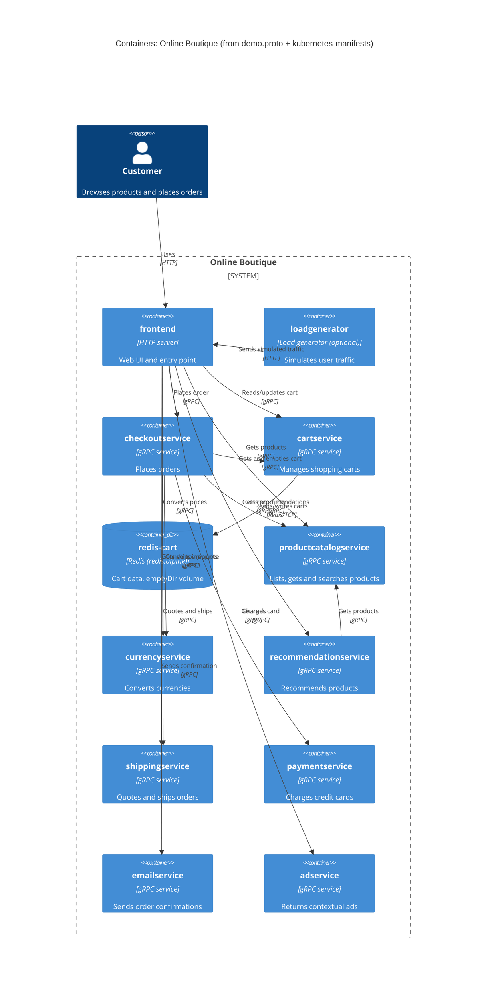

# 1B: Recovered C4 container architecture (Online Boutique)

## 1. Agent

- Product: Claude Code
- Model: Claude Opus 5.5 (`claude-opus-5-5`)

## 2. Files read

Task file: `prompts/1-recover-architecture.md`

Evidence:

- `system/online-boutique/protos/demo.proto`
- `system/online-boutique/kubernetes-manifests/README.md`
- `system/online-boutique/kubernetes-manifests/kustomization.yaml`
- `system/online-boutique/kubernetes-manifests/adservice.yaml`
- `system/online-boutique/kubernetes-manifests/cartservice.yaml`
- `system/online-boutique/kubernetes-manifests/checkoutservice.yaml`
- `system/online-boutique/kubernetes-manifests/currencyservice.yaml`
- `system/online-boutique/kubernetes-manifests/emailservice.yaml`
- `system/online-boutique/kubernetes-manifests/frontend.yaml`
- `system/online-boutique/kubernetes-manifests/loadgenerator.yaml`
- `system/online-boutique/kubernetes-manifests/paymentservice.yaml`
- `system/online-boutique/kubernetes-manifests/productcatalogservice.yaml`
- `system/online-boutique/kubernetes-manifests/recommendationservice.yaml`
- `system/online-boutique/kubernetes-manifests/shippingservice.yaml`

## 3. Containers table

The implementation language of the custom services isn't shown anywhere: the manifests give only bare image names (e.g. `image: cartservice`), and `demo.proto` is language-neutral. So the language column says "Not evidenced" and only the interface technology is given.

| Container | Technology / language | Responsibility | Evidence |
|---|---|---|---|
| `frontend` | HTTP server on port 8080; language not evidenced | Web UI and entry point for the shop. Exposed outside the cluster through a `LoadBalancer` Service | `kubernetes-manifests/frontend.yaml` (Service `frontend-external`, `type: LoadBalancer`; `httpGet` probes on `/_healthz`; cookie `shop_session-id`) |
| `productcatalogservice` | gRPC server on 3550; language not evidenced | Lists, gets and searches products | `protos/demo.proto` (`service ProductCatalogService`: `ListProducts`, `GetProduct`, `SearchProducts`); `kubernetes-manifests/productcatalogservice.yaml` (Service port `grpc` 3550) |
| `currencyservice` | gRPC server on 7000; language not evidenced | Lists supported currencies and converts `Money` between currencies | `protos/demo.proto` (`service CurrencyService`: `GetSupportedCurrencies`, `Convert`); `kubernetes-manifests/currencyservice.yaml` (port `grpc` 7000) |
| `cartservice` | gRPC server on 7070; language not evidenced | Adds items to a user's cart, reads it and empties it | `protos/demo.proto` (`service CartService`: `AddItem`, `GetCart`, `EmptyCart`); `kubernetes-manifests/cartservice.yaml` (port `grpc` 7070) |
| `redis-cart` | Redis (`redis:alpine`) | Stores cart data. Its volume is `emptyDir`, so data does not outlive the pod | `kubernetes-manifests/cartservice.yaml` (Deployment `redis-cart`, `image: redis:alpine`, volume `redis-data: emptyDir`) |
| `recommendationservice` | gRPC server on 8080; language not evidenced | Recommends product IDs for a user and a set of products | `protos/demo.proto` (`service RecommendationService`: `ListRecommendations`); `kubernetes-manifests/recommendationservice.yaml` (port `grpc` 8080) |
| `shippingservice` | gRPC server on 50051; language not evidenced | Gives shipping quotes and ships orders (returns a `tracking_id`) | `protos/demo.proto` (`service ShippingService`: `GetQuote`, `ShipOrder`); `kubernetes-manifests/shippingservice.yaml` (port `grpc` 50051) |
| `checkoutservice` | gRPC server on 5050; language not evidenced | Places an order and returns an `OrderResult` | `protos/demo.proto` (`service CheckoutService`: `PlaceOrder`); `kubernetes-manifests/checkoutservice.yaml` (port `grpc` 5050) |
| `paymentservice` | gRPC server on 50051; language not evidenced | Charges a credit card and returns a `transaction_id` | `protos/demo.proto` (`service PaymentService`: `Charge`); `kubernetes-manifests/paymentservice.yaml` (port `grpc` 50051) |
| `emailservice` | gRPC server; Service port 5000 → container 8080; language not evidenced | Sends the order confirmation email | `protos/demo.proto` (`service EmailService`: `SendOrderConfirmation`); `kubernetes-manifests/emailservice.yaml` (Service port `grpc` 5000, `targetPort: 8080`) |
| `adservice` | gRPC server on 9555; language not evidenced | Returns ads for a page's context keywords | `protos/demo.proto` (`service AdService`: `GetAds`); `kubernetes-manifests/adservice.yaml` (port `grpc` 9555) |
| `loadgenerator` | Language not evidenced; init container uses `busybox:1.38.0` | Simulates user traffic against the frontend (`USERS: 10`, `RATE: 1`). Optional: it is commented out in `kustomization.yaml` | `kubernetes-manifests/loadgenerator.yaml` (`FRONTEND_ADDR`, `USERS`, `RATE`); `kubernetes-manifests/kustomization.yaml` (`# - loadgenerator.yaml`) |

## 4. Dependencies table

How the protocol is known: every callee Service names its port `grpc` and uses `grpc` readiness/liveness probes, and `demo.proto` defines its gRPC interface. The manifests don't show which RPCs each caller uses.

| Caller → callee | Protocol | Evidence |
|---|---|---|
| Customer → `frontend` | HTTP (port 80 → 8080) | `kubernetes-manifests/frontend.yaml` (Service `frontend-external`, `type: LoadBalancer`, port `http` 80) |
| `loadgenerator` → `frontend` | HTTP | `kubernetes-manifests/loadgenerator.yaml` (`FRONTEND_ADDR: "frontend:80"`; init container runs `wget http://${FRONTEND_ADDR}`) |
| `frontend` → `productcatalogservice` | gRPC | `kubernetes-manifests/frontend.yaml` (`PRODUCT_CATALOG_SERVICE_ADDR: "productcatalogservice:3550"`) |
| `frontend` → `currencyservice` | gRPC | `kubernetes-manifests/frontend.yaml` (`CURRENCY_SERVICE_ADDR: "currencyservice:7000"`) |
| `frontend` → `cartservice` | gRPC | `kubernetes-manifests/frontend.yaml` (`CART_SERVICE_ADDR: "cartservice:7070"`) |
| `frontend` → `recommendationservice` | gRPC | `kubernetes-manifests/frontend.yaml` (`RECOMMENDATION_SERVICE_ADDR: "recommendationservice:8080"`) |
| `frontend` → `shippingservice` | gRPC | `kubernetes-manifests/frontend.yaml` (`SHIPPING_SERVICE_ADDR: "shippingservice:50051"`) |
| `frontend` → `checkoutservice` | gRPC | `kubernetes-manifests/frontend.yaml` (`CHECKOUT_SERVICE_ADDR: "checkoutservice:5050"`) |
| `frontend` → `adservice` | gRPC | `kubernetes-manifests/frontend.yaml` (`AD_SERVICE_ADDR: "adservice:9555"`) |
| `checkoutservice` → `productcatalogservice` | gRPC | `kubernetes-manifests/checkoutservice.yaml` (`PRODUCT_CATALOG_SERVICE_ADDR: "productcatalogservice:3550"`) |
| `checkoutservice` → `shippingservice` | gRPC | `kubernetes-manifests/checkoutservice.yaml` (`SHIPPING_SERVICE_ADDR: "shippingservice:50051"`) |
| `checkoutservice` → `paymentservice` | gRPC | `kubernetes-manifests/checkoutservice.yaml` (`PAYMENT_SERVICE_ADDR: "paymentservice:50051"`) |
| `checkoutservice` → `emailservice` | gRPC | `kubernetes-manifests/checkoutservice.yaml` (`EMAIL_SERVICE_ADDR: "emailservice:5000"`) |
| `checkoutservice` → `currencyservice` | gRPC | `kubernetes-manifests/checkoutservice.yaml` (`CURRENCY_SERVICE_ADDR: "currencyservice:7000"`) |
| `checkoutservice` → `cartservice` | gRPC | `kubernetes-manifests/checkoutservice.yaml` (`CART_SERVICE_ADDR: "cartservice:7070"`) |
| `recommendationservice` → `productcatalogservice` | gRPC | `kubernetes-manifests/recommendationservice.yaml` (`PRODUCT_CATALOG_SERVICE_ADDR: "productcatalogservice:3550"`) |
| `cartservice` → `redis-cart` | Redis over TCP (port 6379) | `kubernetes-manifests/cartservice.yaml` (`REDIS_ADDR: "redis-cart:6379"`; Service `redis-cart` port `tcp-redis`) |

`adservice`, `currencyservice`, `emailservice`, `paymentservice`, `productcatalogservice` and `shippingservice` have no `*_ADDR` variables, so the manifests show no outgoing dependencies for them.

## 5. Mermaid diagram

The `Rel` labels describe purpose and come from the RPC names in `demo.proto`. Which RPCs each caller actually uses is **[Inferred]** (see Gaps).

## 6. Gaps

| Gap | What the evidence shows | File that would settle it |
|---|---|---|
| Implementation language of each service | Bare image names only (`image: frontend`, `image: cartservice`, …) | Each service's source folder or `Dockerfile` under `system/online-boutique/src/<service>/` |
| Which RPCs each caller uses (e.g. does `frontend` call `ShippingService.GetQuote` and `checkoutservice` call `ShipOrder`?) | Only the address env vars and the RPC list in `demo.proto` | Caller source, e.g. `src/frontend/` handlers and `src/checkoutservice/` main code |
| `shoppingassistantservice` | `frontend.yaml` sets `SHOPPING_ASSISTANT_SERVICE_ADDR: "shoppingassistantservice:80"`, but none of the evidence files define a Deployment/Service for it, `ENABLE_ASSISTANT` is commented out, and `kustomization.yaml` comments out `shopping-assistant`. Left out of the diagram | `system/online-boutique/kustomize/components/shopping-assistant/` |
| Packaging service | `PACKAGING_SERVICE_URL` in `frontend.yaml` is commented out ("optional Google Cloud demo") | Frontend source that reads `PACKAGING_SERVICE_URL` |
| External systems (real payment gateway, SMTP/email provider, exchange-rate source) | None configured. Payment, email and currency services have no outgoing addresses or credentials in their manifests | `src/paymentservice/`, `src/emailservice/`, `src/currencyservice/` |
| Where product catalog and currency data come from | No data store or volume is configured for `productcatalogservice` or `currencyservice`. **[Inferred]** the data is bundled in the image | `src/productcatalogservice/`, `src/currencyservice/` |
| How carts are stored in Redis (keys, TTL) and whether persistence matters | `redis-cart` uses `emptyDir`, so carts are lost when the pod is rescheduled | `src/cartservice/` |
| Alternative data stores (Memorystore, AlloyDB, Spanner) | Listed only as commented-out components in `kustomization.yaml` | `system/online-boutique/kustomize/components/{memorystore,alloydb,spanner}/` |
| Observability / profiling backend | `ENABLE_PROFILER: "0"` (frontend) and `DISABLE_PROFILER: "1"` (others) refer to a profiler that isn't identified. `google-cloud-operations` is commented out | `kustomize/components/google-cloud-operations/` and service source |
| Service mesh / TLS between services | The `sidecar.istio.io/rewriteAppHTTPProbers` annotation (frontend, loadgenerator) hints at optional Istio. No mTLS or TLS config is in the evidence, and the external entry is plain HTTP on port 80 | Istio / service-mesh manifests (e.g. under `system/online-boutique/istio-manifests/`, if present) |
| Network restrictions between containers | `network-policies` component is commented out, so no policy is evidenced | `kustomize/components/network-policies/` |
| Replica counts and scaling | No `replicas` set except `loadgenerator: 1`. No HPA in the evidence | Any HPA manifests, or `release/` manifests |
| Image tags actually deployed | `README.md` says these manifests need `skaffold` to fill in `image:` tags | `skaffold.yaml` or `system/online-boutique/release/kubernetes-manifests.yaml` |
| Implementation of the health checks | Services use `grpc` probes, but `demo.proto` declares no health service. **[Inferred]** they implement the standard gRPC health-checking protocol | Service source, or the gRPC health proto if vendored |
