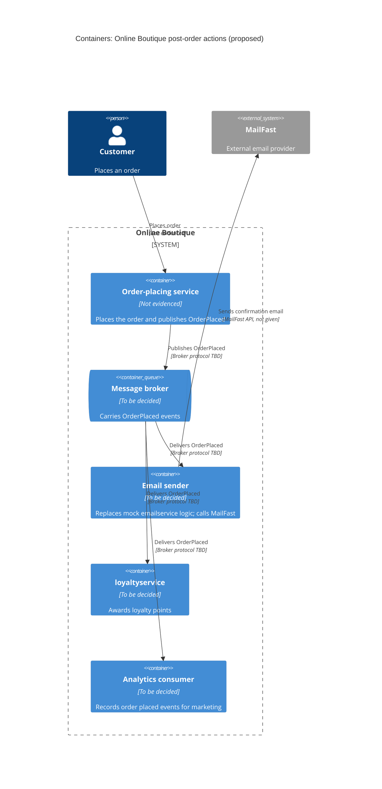

Agent: Claude Code · Model: Claude Opus 5.5 (`claude-opus-5-5`) · Run: a (zero-shot, `context: none`)

# ADR-0002: Publish an "order placed" event to a message broker for post-order actions

- **Status:** Proposed
- **Date:** 2026-10-27
- **Deciders:** Not given in the requirement (see Open questions)

## Context and problem

Source: the requirement text only. No system files were read in this run, so nothing here is checked against the current Online Boutique code.

After an order is placed, Online Boutique must do three new things:

| # | Action | Owner / target | Given in requirement |
|---|---|---|---|
| 1 | Send order confirmation email | **MailFast**, a new external email provider, replacing the mock `emailservice` logic | Yes |
| 2 | Award loyalty points | New `loyaltyservice` (to be built) | Yes |
| 3 | Record an "order placed" analytics event | Marketing team | Yes |

- Marketing expects **more post-order actions next year** (SMS, fraud scoring, a recommendations update).
- So the problem is not only "add three calls". It is: **how should the service that places an order trigger a growing set of post-order actions**, some of which depend on an external provider (MailFast) outside our control?
- Which service places the order today, how it calls `emailservice`, and whether a message broker already exists: **Not evidenced in the provided files.**
- Latency, volume, availability targets and delivery guarantees: **not given** (see Open questions).

## Decision drivers

Ordered by importance. The order is my reading of the requirement, not something the requirement states.

1. **Modifiability / extensibility:** adding SMS, fraud scoring and a recommendations update next year should not mean changing the order-placing service each time.
2. **Availability of order placement:** a MailFast outage, or a fault in `loyaltyservice` or analytics, should not make placing an order fail. **[Inferred]** The requirement doesn't say this, but these are all "after the order is placed" actions.
3. **Reliability of each action:** an email, loyalty award or analytics event should not be silently lost. The delivery guarantee each one needs is not given.
4. **Performance (checkout latency):** post-order work should add as little as possible to the time the customer waits for order confirmation. No latency budget is given.
5. **Isolation from the external provider:** keep MailFast-specific code (API, credentials, retries, rate limits) in one place so the provider can be changed later.
6. **Cost and operational complexity:** new infrastructure has to be run and monitored. Team skills and budget are not given.

## Considered options

1. **A: Synchronous fan-out.** After the order is placed, the order-placing service calls each action directly and in turn: the email adapter/MailFast, `loyaltyservice`, and analytics.
2. **B: Event-driven publish/subscribe.** The order-placing service publishes one `OrderPlaced` event to a message broker. Independent consumers subscribe to it: an email sender (MailFast adapter), `loyaltyservice`, and an analytics consumer. Future actions add new subscribers.
3. **C: Dedicated post-order orchestrator.** The order-placing service makes one call (or sends one message) to a new `postorderservice`. That service runs the post-order steps in a defined workflow, with retries and per-step status.

### Pros and cons of the options

| Option | Pros | Cons |
|---|---|---|
| A: Synchronous fan-out | Simplest: no new infrastructure. Easy to trace and debug in one call chain. The caller knows straight away whether each step worked. | Every new action changes and redeploys the order-placing service (poor modifiability). Checkout latency is the **sum** of all calls, MailFast included. A failure or slow response in any step can fail or delay the order unless every call gets its own timeout and error handling. Retries for MailFast live inside the order path. Tight coupling to every downstream service. |
| B: Publish/subscribe via broker | A new action is a new subscriber; the publisher doesn't change (high modifiability). Order placement returns once the event is published, so latency doesn't depend on MailFast or the other consumers. Each consumer retries on its own and can be scaled or deployed on its own. A MailFast outage only affects the email consumer. Analytics can read the same event stream. | New infrastructure to run (broker, monitoring, dead-letter queues). Eventual consistency: email or points arrive later, not by the time the order response is sent. At-least-once delivery means consumers must be idempotent (no duplicate emails or points). Publishing the event and committing the order must not drift apart, which may need an outbox or similar. Harder end-to-end tracing. Event schema becomes a contract to version. |
| C: Post-order orchestrator | One place that defines the order of steps, retries and status per order. Good if steps start to depend on each other (e.g. fraud scoring before loyalty points). The order-placing service only knows one dependency. | Each new action still means changing the orchestrator, so modifiability improves only partly. A new service to build and run that can become a bottleneck or single point of failure. If called synchronously, the latency and availability problems of A remain. If called asynchronously, it still needs a queue, so it adds B's infrastructure as well. |

## Decision

**Choose Option B: publish an `OrderPlaced` event to a message broker, with one consumer per post-order action.**

- The email consumer is the only component that talks to **MailFast**. It replaces the mock `emailservice` logic and keeps the provider behind one adapter (driver 5).
- `loyaltyservice` is built as a consumer of `OrderPlaced`.
- Analytics records the "order placed" event by consuming the same event (driver 1), so the order path doesn't need a separate analytics call.
- **Why:** it best fits the top two drivers. Next year's SMS, fraud scoring and recommendations update become new subscribers without touching order placement (modifiability), and a MailFast or `loyaltyservice` failure no longer blocks an order (availability, performance). Option A fails driver 1 and puts MailFast in the order's critical path. Option C helps with sequencing but still needs a change for each new action.
- **Not decided here:** which broker technology to use. That depends on facts this run doesn't have (existing infrastructure, team skills, cost, ordering and retention needs). See Open questions.
- **Revisit:** if a future action, such as fraud scoring, must **block or change** the order before it is confirmed, it isn't a post-order action and needs a synchronous call or an orchestrated step (Option C for that flow only).

Proposed shape (new elements only; the order-placing service is not named because this run didn't verify which service it is):

## Consequences

- **Positive:** New post-order actions (SMS, fraud scoring, recommendations update) are added as new subscribers, with no change to the order-placing service. (quality attribute: **modifiability**)
- **Positive:** Order placement no longer waits for MailFast, `loyaltyservice` or analytics, so it isn't slowed by them. (quality attribute: **performance**)
- **Positive:** A MailFast outage or a consumer bug doesn't fail the order; events wait in the broker and are retried. (quality attribute: **availability**, **fault isolation**)
- **Positive:** MailFast is behind one adapter, so changing provider later is a local change. (quality attribute: **modifiability**, **interoperability**)
- **Positive:** Each consumer scales on its own, e.g. analytics during marketing campaigns. (quality attribute: **scalability**)
- **Negative:** The broker is new infrastructure to deploy, secure, monitor and pay for. (quality attribute: **cost**, **operability**)
- **Negative:** Email and loyalty points arrive with a delay; the order response can't promise they're done. (quality attribute: **consistency**, **usability**)
- **Negative:** Following one order across several consumers is harder. (quality attribute: **observability**, **testability**)
- **Risks and mitigations:**
  - *Order committed but event lost, or event published for an order that failed* → publish atomically with the order commit (e.g. transactional outbox), or document the accepted gap. Depends on how orders are stored, which is **not evidenced**.
  - *Duplicate delivery → two emails or double points* → consumers are idempotent, keyed on order ID.
  - *Poison messages or long MailFast outage* → bounded retries with backoff, a dead-letter queue, and an alert on its depth.
  - *Event schema changes break consumers* → version the `OrderPlaced` schema and only add fields in a backward-compatible way.
  - *Broker becomes a single point of failure* → run it highly available; the right setup depends on the broker chosen and the availability target (not given).
  - *Order data sent to MailFast and analytics (personal data, e.g. email address)* → limit the fields in the event each consumer needs; data-handling rules are not given.

## Validation

- **Fault-injection test:** make MailFast (or a stub of it) unavailable and place orders. Orders must still succeed, and emails must be sent after recovery with no loss or duplicates.
- **Latency comparison:** measure checkout latency before and after the change. The target is **not given** (see Open questions).
- **Idempotency test:** deliver the same `OrderPlaced` event twice; exactly one email and one loyalty award result.
- **Extensibility check:** add a stub subscriber (e.g. a no-op "SMS" consumer) without changing or redeploying the order-placing service.
- **Operational metrics:** consumer lag, dead-letter queue depth, MailFast error rate, and the share of orders with email sent / points awarded within an agreed time (time not given).
- **Review date:** before the first of next year's post-order actions (SMS, fraud scoring, recommendations update) is built. No exact date is given.

## Open questions

- Which service places orders today, and how does it currently call `emailservice` (protocol, sync or async)? Not evidenced in the provided files.
- Does Online Boutique already run a message broker or any async messaging? What infrastructure and platform does it run on?
- Quality targets: checkout latency budget, availability target, order volume and peak load.
- Delivery guarantees per action: must every email, loyalty award and analytics event be delivered exactly once, at least once, or is best-effort OK (e.g. for analytics)?
- How quickly after the order must the email arrive and the points be credited?
- MailFast details: API type, rate limits, SLA, cost per email, retry and idempotency support, webhooks for bounces.
- `loyaltyservice` scope: rules for points, its own data store, and whether points must be reversed on cancellation or refund.
- Analytics: what system marketing uses, what fields the event needs, and any privacy or consent rules for customer data.
- Will fraud scoring (planned next year) need to run **before** the order is confirmed? If yes, it doesn't fit this post-order event flow.
- Team skills and budget for running a broker; who the deciders are.
