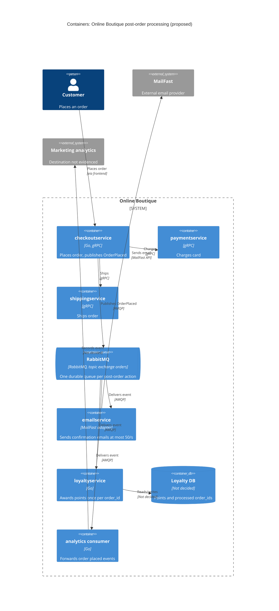

> Agent: Claude Code · Model: Claude Opus 5.5 (`claude-opus-5-5`) · Run: b (with context)

# ADR-0002: Publish an "order placed" event to RabbitMQ for post-order actions

- **Status:** Proposed
- **Date:** 2026-10-27
- **Deciders:** Online Boutique development team (4 developers), to be reviewed

## Context and problem

Requirement R-12 (`docs/scenario.md`) adds three post-order actions: a confirmation email through **MailFast** (an external provider that replaces the mock `emailservice` logic), **loyalty points** through a new `loyaltyservice`, and an **"order placed" analytics event**. Marketing expects **more post-order actions next year** (SMS, fraud scoring, recommendations update).

**How it works today** (`system/online-boutique/src/checkoutservice/main.go`):

- `PlaceOrder` (line 230) runs everything **synchronously over gRPC, in sequence**: cart and quote (`prepareOrderItemsAndShippingQuoteFromCart`, line 238), `chargeCard` (line 252), `shipOrder` (line 258), `emptyUserCart` (line 263), then `sendOrderConfirmation` (line 273).
- A failed email is only logged (`log.Warnf`, line 274). The order still succeeds.
- `sendOrderConfirmation` (lines 379-384) uses the caller's `ctx` with no timeout of its own, so a slow email call delays the `PlaceOrder` response by its full duration.
- `checkoutService` holds only gRPC client connections (lines 66-86). It has **no database of its own**.
- An order ID is generated per order (`uuid.NewUUID()`, line 233), and the request carries `UserId` and `Email` (lines 231, 273). The order total is computed (lines 243-250) but is **not** part of `OrderResult` (lines 265-271).
- Trace context is propagated with OpenTelemetry (lines 134-140).

**Facts that constrain the decision** (`docs/scenario.md`):

| Topic | Fact | Consequence for the design |
|---|---|---|
| Checkout latency | p95 `PlaceOrder` ≤ **500 ms** (today approximately 300 ms) | Leaves about 200 ms of headroom. MailFast's p95 alone (1.5 s) is 3× the whole budget. |
| Peak load | **200 orders/s** (11.11 sale) | — |
| MailFast | p95 1.5 s, p99 8 s, approximately 0.5 % failures, rate limit **50 emails/s** | At peak, orders arrive 4× faster than MailFast accepts emails: a backlog grows by **150 emails/s** (9,000 per minute of peak). Emails must be **buffered and retried**, not sent in-line. |
| Loyalty points | within **1 minute**, **exactly once** | Must not wait behind the email backlog. Needs retries plus de-duplication. |
| Availability | an order must **never fail** because email, loyalty or analytics is down | Post-order actions must be isolated from the order's success path. |
| Team | 4 devs, strong in Go and gRPC, **two have used RabbitMQ** | Favours Go consumers and RabbitMQ over unfamiliar tech. |
| Operations | Kubernetes; prefers **open-source, self-hosted** | Rules out cloud-only managed queues. |

**Problem:** how should `checkoutservice` trigger the post-order actions so that checkout stays within 500 ms at 200 orders/s, never fails because of a post-order action, respects MailFast's 50/s limit, awards loyalty points exactly once within 1 minute, and lets new actions be added next year without changing checkout again?

## Decision drivers

1. **Availability:** an order must never fail because email, loyalty or analytics is down.
2. **Performance:** `PlaceOrder` p95 ≤ 500 ms at 200 orders/s.
3. **Reliability / correctness:** loyalty points exactly once, within 1 minute. Emails not lost despite the 0.5 % MailFast failures and the 50/s rate limit.
4. **Modifiability:** add SMS, fraud scoring, recommendations next year with no change to `checkoutservice`.
5. **Team fit and operations:** Go/gRPC skills, RabbitMQ experience, open-source and self-hosted on Kubernetes.

## Considered options

1. **Extend the synchronous gRPC chain:** `PlaceOrder` calls MailFast (via `emailservice`), `loyaltyservice` and an analytics endpoint in sequence, as it calls `emailservice` today.
2. **In-process async calls:** `PlaceOrder` returns, and goroutines inside `checkoutservice` call the three actions with in-memory retries.
3. **Event-driven with RabbitMQ (self-hosted):** `checkoutservice` publishes one `OrderPlaced` event to a topic exchange. Each action is a separate consumer with its own durable queue.
4. **Event-driven with Apache Kafka (self-hosted):** same publish/subscribe shape, using a Kafka topic and consumer groups.

### Pros and cons of the options

| Option | Pros | Cons |
|---|---|---|
| 1. Sync gRPC chain | No new infrastructure. Same pattern the team knows (`main.go` lines 252-277). Caller sees the result at once. | MailFast p95 1.5 s / p99 8 s **breaks the 500 ms p95**. At 200 orders/s, 150 emails/s exceed the 50/s limit and are rejected or delayed in-line. A failed or slow `loyaltyservice` blocks or degrades checkout. Each new action adds latency and a code change in `checkoutservice`. |
| 2. In-process goroutines | Fast response. No new infrastructure. Small change. | Work is **lost if a pod restarts** (no durable buffer for a backlog of 150 emails/s). A 50/s **global** rate limit is hard to enforce across several `checkoutservice` replicas. Exactly-once loyalty is hard without durable retries. New actions still need checkout changes. |
| 3. RabbitMQ events | Checkout only adds one publish, so it stays within the latency budget **[Inferred]**, to be measured. Durable queues **buffer the email backlog** and drain at ≤ 50/s. **Separate queues** keep the loyalty path apart from the email backlog. Failed consumers do not affect orders. New actions = **new queue bound to the exchange**, no checkout change. Two devs know RabbitMQ. Open source, runs on Kubernetes. | A new stateful component to operate. Delivery is **at-least-once**, so consumers must be idempotent. The publish itself is a new dependency of `PlaceOrder` (see Risks). No built-in long-term replay of past events. Async flows are harder to trace and debug. |
| 4. Kafka events | Same decoupling as option 3. Durable log with **replay**, useful for analytics and for backfilling new consumers (e.g. recommendations). High throughput. | **No Kafka experience** in the team is evidenced (only RabbitMQ). Heavier to run self-hosted (brokers, partitions, retention tuning). Per-message retry and delay queues for MailFast failures need extra work. At-least-once is still the practical default, so idempotency is still needed. |

## Decision

Choose **option 3: publish an `OrderPlaced` event to a self-hosted RabbitMQ cluster**, with one durable queue per post-order action.

- **Producer (`checkoutservice`):** replace the in-line `sendOrderConfirmation` call (`main.go` lines 273-277) with a publish to the topic exchange `orders` (routing key `order.placed`), using publisher confirms and a **short timeout** (value: open question). The event carries `order_id` (line 233), `user_id`, `email`, the `OrderResult` fields (lines 265-271), the **order total** (lines 243-250, today not in `OrderResult`) and the trace context (lines 134-140). If the publish fails, log a warning and **still return the order**, as today's email path does (line 274).
- **`emailservice` (MailFast adapter):** consumes queue `email.order-placed`. It sends through MailFast with a **global 50 emails/s rate limit**, retries the approximately 0.5 % failures with backoff via a delay/retry queue, and moves messages to a dead-letter queue after N attempts (N: open question).
- **`loyaltyservice` (new, Go):** consumes its own queue `loyalty.order-placed`. It achieves **exactly-once effect** through at-least-once delivery plus an **idempotent consumer**: it records `order_id` under a unique constraint in the same transaction as the points award, so a redelivered event awards nothing. It acknowledges only after the commit. Its own queue means it is never stuck behind the email backlog.
- **Analytics consumer:** consumes `analytics.order-placed` and forwards to the marketing destination (open question).
- **Next year:** SMS, recommendations and post-order fraud scoring each add a queue bound to `order.placed`. `checkoutservice` does not change.

Why: it is the only option that meets drivers 1-4 together (option 1 fails performance and availability, option 2 fails reliability). It also fits the team's RabbitMQ experience and the open-source, self-hosted preference better than Kafka (driver 5).

## Consequences

- **Positive:** MailFast's 1.5 s / 8 s latency leaves the checkout path. `PlaceOrder` adds only a publish, so it should stay near today's approximately 300 ms, against a 500 ms budget **[Inferred]**, to be measured (quality attribute: performance).
- **Positive:** email, loyalty or analytics outages no longer affect orders. Events wait in their queues until the consumer recovers (quality attribute: availability).
- **Positive:** the email backlog at peak (150 emails/s above the limit) is absorbed by a durable queue instead of failing (quality attribute: reliability / scalability).
- **Positive:** new post-order actions are added by binding a new queue, with no change to `checkoutservice` (quality attribute: modifiability).
- **Positive:** the team's Go and RabbitMQ skills are reused, and the components are open source and self-hosted (quality attribute: cost / operability).
- **Negative:** a new stateful component (RabbitMQ cluster, storage, monitoring) to run (quality attribute: operability / cost).
- **Negative:** confirmation emails become **eventually** delivered. At 11.11 they may lag by minutes, and the lag grows with the peak's length (quality attribute: performance, i.e. email latency as the customer sees it).
- **Negative:** at-least-once delivery means a consumer can see the same event twice. Loyalty handles this with de-duplication; a duplicate email is possible unless MailFast supports an idempotency key (quality attribute: correctness).
- **Negative:** async flows are harder to debug. Trace context must be carried in message headers to keep end-to-end traces (quality attribute: observability).
- **Risks and mitigations:**
  - **Lost event if the publish fails** (RabbitMQ down or slow). The order still succeeds (driver 1), but its email, points and analytics event are lost, which **breaks "loyalty exactly once"**. A transactional outbox would close this gap, but `checkoutservice` has no database (`main.go` lines 66-86). Mitigate with a replicated RabbitMQ cluster (quorum queues), publisher confirms plus a bounded local retry, an alert on publish failures, and a reconciliation job if orders are recorded elsewhere. Whether an outbox database is required is an open question.
  - **MailFast rate limit exceeded** when several `emailservice` replicas each send at full speed. Mitigate with one shared limit (e.g. a single active consumer, or a per-replica limit = 50 / replicas). This is a **sensitivity point**: throughput is fixed by the 50/s limit, whatever the number of replicas.
  - **Loyalty misses the 1-minute target** at 200 events/s. Mitigate by sizing `loyaltyservice` consumers and prefetch for ≥ 200 events/s, and alerting on queue age.
  - **Poison messages** block a queue. Mitigate with dead-letter queues and a runbook for replaying them.
  - **Fraud scoring may need to block the order** (run before payment). If so, it does not fit this async pattern and needs its own decision.
  - **Customer PII** (`email`, address) is now stored in the broker. Mitigate with access control and TLS on AMQP. The privacy requirements are not given.

## Validation

- **Load test at 200 orders/s** (e.g. with the Locust `loadgenerator` named in ADR-0001): `PlaceOrder` p95 ≤ 500 ms, with MailFast stubbed at p95 1.5 s / p99 8 s / 0.5 % failures.
- **Fault injection:** stop `emailservice`, `loyaltyservice` and the analytics consumer one at a time during the load test. Expect **0 failed orders** caused by them, and every queued event processed after recovery.
- **Loyalty metrics:** time from `order_id` creation to points award p99 < 60 s at peak. **0 order_ids with more than one award** (checked through the unique constraint and a nightly count). Redelivery test: publish the same event twice, expect one award.
- **Email metrics:** MailFast send rate never above 50/s (0 rate-limit rejections). Dead-letter queue size and email queue age monitored and alerted.
- **Broker failure test:** kill one RabbitMQ node under load, and measure lost events and publish failures.
- **Review date:** after the 11.11 sale (2026-11-11), using its real peak, queue-age and email-lag data. Review again before adding the first new post-order action.

## Open questions

- **11.11 peak duration** and the **maximum acceptable email delay**. Both are needed to size the email backlog (150 emails/s × peak seconds) and to know whether customers will accept the lag.
- **Publish failure policy:** is losing loyalty points acceptable when the broker is down? If not, `checkoutservice` needs a database for a transactional outbox, or another order store must be used for reconciliation (not evidenced in the provided files).
- **Publish timeout budget** inside the remaining approximately 200 ms of latency headroom.
- **MailFast API details:** idempotency-key support (to avoid duplicate emails), how it signals a rate-limit breach, and whether retries count against the 50/s.
- **Loyalty rules:** how many points per order, in which currency (the total is in `UserCurrency`, `main.go` line 243), and which data store `loyaltyservice` uses.
- **Analytics destination** for marketing (tool, protocol), and whether lost or duplicate analytics events are acceptable.
- **Fraud scoring timing:** post-order (fits this design) or pre-payment (blocking; needs a separate decision).
- **Retry limits and dead-letter ownership:** how many attempts, and who handles dead-lettered emails and awards.
- **RabbitMQ operations:** cluster size, persistent storage, and who is on call for it.
- **Privacy and security** rules for customer email and address carried in events.
- **`emailservice` scope:** the requirement says MailFast "replaces the mock `emailservice` logic". This ADR assumes `emailservice` stays as the MailFast adapter; confirm this. Its current implementation is not in the provided files.
